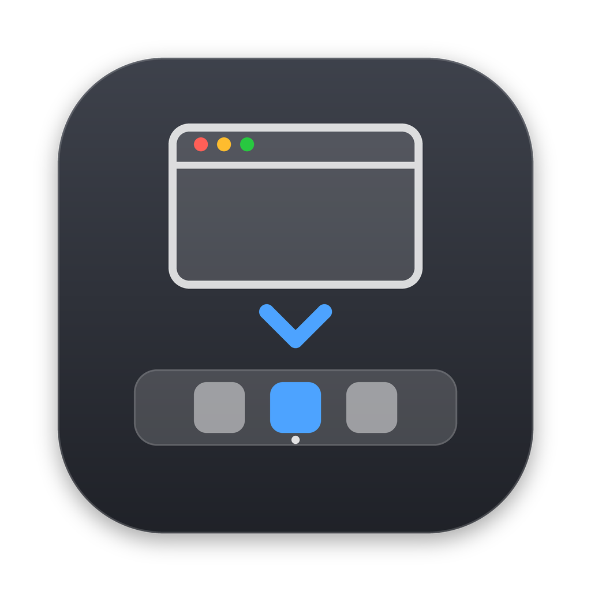

<p align="center">
  
</p>

<h1 align="center">DockToggle</h1>

<p align="center">
  <a href="LICENSE"></a>
  
  
  
  
</p>

macOS Dock'una Windows görev çubuğu davranışı kazandıran, minimum kaynak tüketen, native bir araç.

macOS'ta öndeki uygulamanın Dock simgesine tıklamak hiçbir şey yapmaz; ⌘Tab ile tüm pencereleri küçültülmüş bir uygulamaya geçmek de ekrana pencere getirmez. DockToggle bu iki boşluğu Windows'taki gibi doldurur. Menü çubuğu simgesi ya da penceresi yoktur; tamamen arka planda, olay tabanlı çalışır.

## Özellikler

- **Dock'tan küçült:** Öndeki uygulamanın Dock simgesine tıklayınca pencereleri küçültülür (veya ayara göre uygulama gizlenir). Tekrar tıklayınca macOS'un kendi davranışıyla geri açılır.
- **⌘Tab ile geri getir:** ⌘Tab, Spotlight ya da bir klavye kısayoluyla seçilen uygulamanın tüm pencereleri küçültülmüşse pencereler geri açılır. Fareyle yapılan geçişlere (masaüstü tıklaması, Dock) dokunulmaz.
- Çoklu ekran, farklı ölçekleme, Dock konumu (alt/sol/sağ) ve büyütme ayarıyla çalışır
- ⌘ / ⌥ / ⌃ / ⇧ basılıyken yapılan Dock tıklamaları dokunulmadan macOS'a bırakılır
- [Hammerspoon](https://www.hammerspoon.org/) ile girişte başlatılabilir
- Polling yok: boşta ~0% CPU, ~8 MB RAM

## Kurulum

Xcode'a gerek yok, sadece Command Line Tools yeterli:

```bash
xcode-select --install   # zaten kuruluysa atla
```

```bash
git clone https://github.com/demir1283/docktoggle.git
cd docktoggle
./build.sh --install
```

Bu komut uygulamayı derler, `/Applications`'a kurar ve başlatır. İlk açılışta **Erişilebilirlik** izni istenir (Sistem Ayarları › Gizlilik ve Güvenlik › Erişilebilirlik); izni verdiğin anda kendiliğinden çalışmaya başlar.

Sadece derleyip kurmadan denemek istersen `./build.sh` yeterli; çıktı `build/` klasörüne gelir. Bu klasör Spotlight ve Launchpad'den gizlenir, bu yüzden uygulama listesinde iki kopya görünmez.

> Uygulama ad-hoc imzalı olduğu için her derlemede imzası değişir ve macOS eski izni yeni sürüme geçirmez. `--install` bu yüzden eski izin kaydını sıfırlar; her kurulumda izin istemi bir kez gelir.

## Kullanım

Arayüz yoktur; ayarlar `defaults` ile değiştirilir ve anında geçerli olur:

```bash
# Öndeki uygulamanın Dock simgesine tıklanınca
defaults write com.local.docktoggle mode -string minimize   # pencereleri küçült (varsayılan)
defaults write com.local.docktoggle mode -string hide       # uygulamayı gizle (⌘H)

# ⌘Tab ile tüm pencereleri küçültülmüş bir uygulamaya geçilince
defaults write com.local.docktoggle restore -string all     # tüm pencereleri aç (varsayılan)
defaults write com.local.docktoggle restore -string one     # yalnızca bir pencereyi aç
defaults write com.local.docktoggle restore -string off     # kapalı

# Tümünü geçici olarak kapat / aç
defaults write com.local.docktoggle enabled -bool false
defaults write com.local.docktoggle enabled -bool true
```

Kapatmak için: `pkill -x DockToggle`

## Hammerspoon entegrasyonu

DockToggle'ın kendi "girişte başlat" ayarı yoktur; başlatmayı Hammerspoon'a bırakır. `examples/hammerspoon-example.lua` dosyasına bak. Özetle:

```lua
local function ensureDockToggle()
    if not hs.application.get("com.local.docktoggle") then
        hs.task.new("/usr/bin/open", nil, { "-g", "-b", "com.local.docktoggle" }):start()
    end
end

ensureDockToggle()
```

Fonksiyon DockToggle zaten çalışıyorsa hiçbir şey yapmaz; config yeniden yüklendiğinde tekrar açmaz. Ekran değişimi ya da uyanma izleyicilerine de ekleyebilirsin; DockToggle kapanmışsa geri gelir.

## Nasıl çalışır

**Dock tıklamaları.** Bir `CGEventTap` sol tıklamaları dinler ve her tıklamayı ucuzdan pahalıya üç aşamada eler:

1. **Kenar şeridi (IPC'siz):** Dock'un kenarı ve kalınlığı Dock'un tercihlerinden ve gerçek boyutundan bilinir. Tıklama, bulunduğu ekranın o kenarındaki şeritte değilse hiçbir işlem yapılmadan geçer. Tıklamaların neredeyse tamamı burada elenir.
2. **Tek Accessibility sorgusu:** Noktadaki öğe Dock sürecine ait bir uygulama simgesi (`AXApplicationDockItem`) mi?
3. **Davranış:** Simge öndeki uygulamaya aitse ve görünür penceresi varsa tıklama yutulur ve pencereler küçültülür. Diğer her durumda tıklama Dock'a olduğu gibi geçer.

**⌘Tab geri getirme.** Ek bir olay dinlemez: uygulama değişiminde gelen sistem bildirimiyle çalışır ve etkinleşen uygulamaya tek bir Accessibility sorgusu yapar. Etkinleşmeden önceki 0,5 saniye içinde fare tıklaması olduysa geçişin fareyle yapıldığı kabul edilir ve dokunulmaz.

Tanılama kayıtlarını izlemek için:

```bash
log stream --level debug --predicate 'subsystem == "com.local.docktoggle"'
```

**Bilinen sınırlamalar:**

- ⌘Tab'ın gezinme sırasında üzerine gelinen uygulamayı canlı göstermek, sistem değiştiricisini tamamen değiştirmeyi gerektirir (AltTab gibi). DockToggle bunun yerine ⌘ bırakıldığında çalışır.
- Bir uygulamanın son penceresini küçülttükten sonra uygulama hâlâ öndeyse, ⌘Tab ile ona yeniden geçmek bir "uygulama değişti" bildirimi üretmez; pencere bu durumda geri gelmez.
- Bazı uygulamalar (ör. bazı Electron/Java uygulamaları) Accessibility üzerinden küçültmeyi yok sayabilir; bunlar için `mode hide` daha güvenilirdir.

## Lisans

MIT — bkz. [LICENSE](LICENSE).
